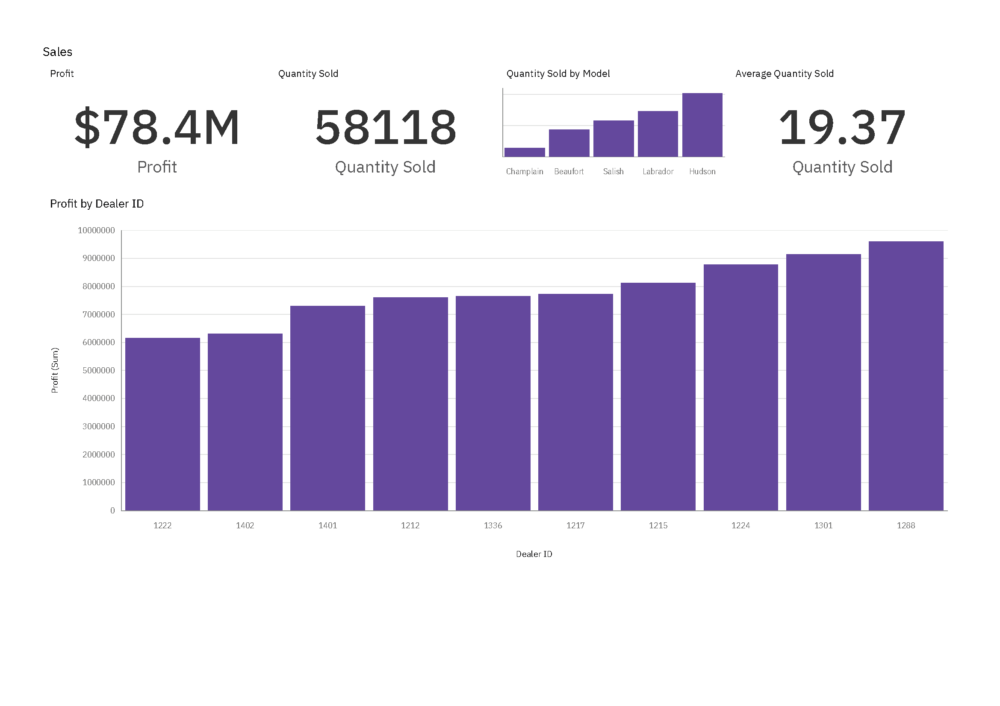
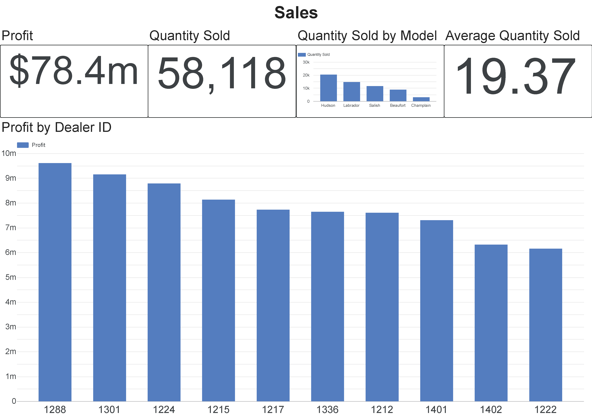
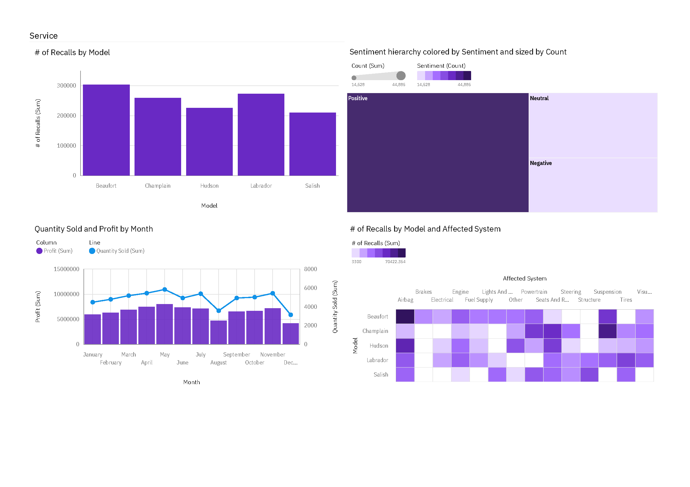
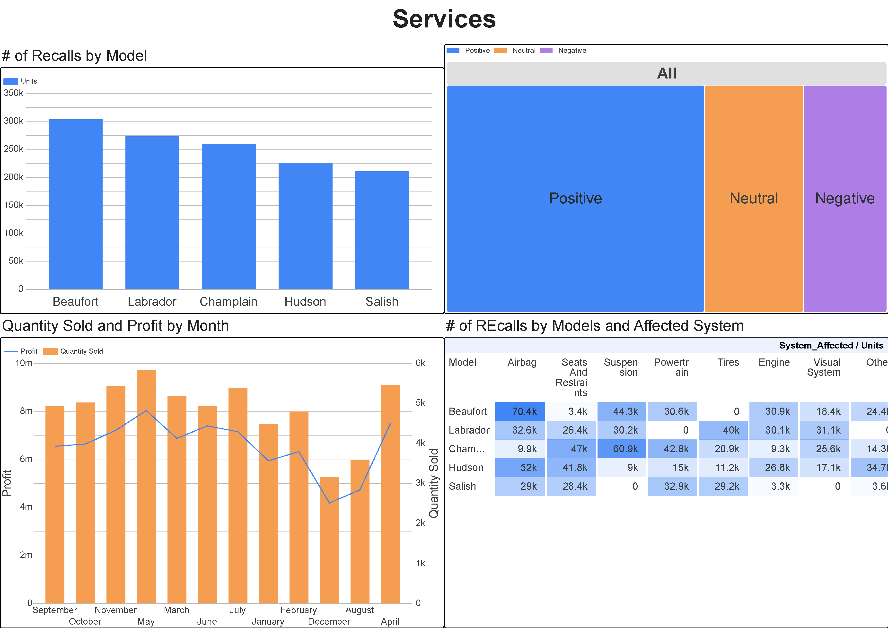
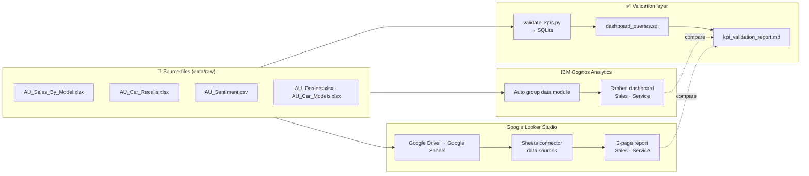

<div align="center">

# 🚗 Swift Auto Traders: BI Dashboards in IBM Cognos Analytics & Google Looker Studio

**Sales and service dashboards for a chain of car dealerships, built in two BI tools from the same requirements, with every KPI cross-checked against the raw data in SQL and Python.**


[](https://github.com/SaBuMa/bi-dashboards-cognos-looker/actions/workflows/validate-kpis.yml)


</div>

---

## 📌 Table of Contents

- [Business Scenario](#-business-scenario)
- [Dashboards](#-dashboards)
- [Headline KPIs](#-headline-kpis)
- [Key Insights](#-key-insights)
- [Architecture](#-architecture)
- [KPI Validation (SQL + Python)](#-kpi-validation-sql--python)
- [Repository Structure](#-repository-structure)
- [How to Reproduce](#-how-to-reproduce)
- [Skills Demonstrated](#-skills-demonstrated)
- [Documentation](#-documentation)
- [Author](#-author)

---

## 🏢 Business Scenario

As the **regional manager** of *Swift Auto Traders*, a chain of 10 car dealerships in the Denver / Colorado area, I needed a way to monitor two departments at a glance:

| Department | Questions the dashboard answers |
|---|---|
| **Sales** | How much profit and volume are we generating? Which models sell the most? Which dealerships are the most and least profitable? |
| **Service** | Which models are recalled most, and for which systems? How do customers feel about us? How do volume and profit move through the year? |

The same requirements were implemented twice, once in **IBM Cognos Analytics** and once in **Google Looker Studio**, so the two tools can be compared side by side. See [`docs/requirements.md`](docs/requirements.md) for the panel-by-panel specification.

---

## 📊 Dashboards

### Sales dashboard

| IBM Cognos Analytics | Google Looker Studio |
|:---:|:---:|
|  |  |
| 4 KPI tiles + Profit by Dealer (ascending) | 4 KPI tiles + Profit by Dealer (descending) |

### Service dashboard

| IBM Cognos Analytics | Google Looker Studio |
|:---:|:---:|
|  |  |
| Column · Treemap · Combo · Heat map | Column · Treemap · Combo · Pivot heat map |

📄 Full PDF exports: [Cognos](dashboards/cognos-analytics/cognos-dashboards-export.pdf) · [Looker Studio](dashboards/looker-studio/looker-studio-report-export.pdf)

---

## 🎯 Headline KPIs

| KPI | Value | Definition |
|---|---:|---|
| Total profit | **$78.4M** | `SUM(profit)`, 2021–2025 |
| Units sold | **58,118** | `SUM(quantity_sold)` |
| Avg. units per record | **19.37** | `AVG(quantity_sold)` per model × dealer × month |
| Top-selling model | **Hudson** | 20,365 units (35% of volume) |
| Most-profitable dealer | **1288 · Northern Auto Sales** | $9.6M |
| Most-recalled model | **Beaufort** | 303K recalled units |
| Positive reviews | **58.6%** | 44,885 of 76,629 reviews |

All definitions are listed in the [KPI catalog](docs/kpi-catalog.md).

---

## 💡 Key Insights

The required dashboards answer *what*. I followed up in SQL to see *why*. Full write-up: [`docs/insights.md`](docs/insights.md).

1. **Volume ≠ profit.** Salish brings in **44% of profit from only 20% of units** (~$3,000 profit per car), while Hudson, the volume leader, earns **$565 per car**.
2. **Customer sentiment is getting worse.** Negative reviews rose from **15.0% (2021) to 25.6% (2024)**, and the increase is the same at every dealership (17.9%–19.8% overall), which points to a product issue rather than one bad showroom. *Fluid leaks* is the top complaint by a factor of 2.4.
3. **Recall outliers.** Two cells stand out in the heat map: **Beaufort × Airbag (70.4K units)** and **Champlain × Suspension (60.9K units)**. Airbags are the most-recalled system overall.
4. **Seasonality.** Sales peak in **May** and drop sharply in **August** and **December**, which matters for inventory and staffing plans.
5. **Data-quality findings.** The validation script found that the 2020 recall records are an **exact copy of 2021**, and 30 recall rows contain **fractional vehicle counts**. Both affect the Service dashboard and are documented in [`data/README.md`](data/README.md).

<p align="center">
  
  
</p>

---

## 🏗 Architecture



---

## ✅ KPI Validation (SQL + Python)

A dashboard is only as trustworthy as its numbers, so the repo includes a small **validation layer**:

- [`sql/dashboard_queries.sql`](sql/dashboard_queries.sql): every dashboard panel written as a SQL query (plus supporting analysis queries).
- [`analysis/validate_kpis.py`](analysis/validate_kpis.py): loads the raw files into an in-memory SQLite database, runs each query, compares the results with what the dashboards display, and runs data-quality checks.
- [`reports/kpi_validation_report.md`](reports/kpi_validation_report.md): generated report, **15 / 15 checks passing**.

```text
$ python analysis/validate_kpis.py

[PASS] Sales P1    Total profit ($M, 1 dp)                  $78.4M
[PASS] Sales P2    Total quantity sold                      58,118
[PASS] Sales P4    Average quantity sold                    19.37
[PASS] Sales P5    Dealer ranking by profit (low → high)    1222 → 1402 → ... → 1301 → 1288
[PASS] Service P4  Cell Beaufort x Airbag                   70.4k
...
[WARN] Recall units are whole vehicles: 30 of 163 rows hold fractional units
[WARN] No recall year is a copy of another year: identical years: 2020 = 2021

15/15 dashboard checks passed.
```

**Dataset versioning.** The course has published two releases of these files. Running the script with `--dataset legacy` shows that the older release would give **$78.3M** instead of $78.4M and a different recall ranking (**9 / 15 checks**, see [`reports/kpi_validation_report_legacy.md`](reports/kpi_validation_report_legacy.md)). This confirms which release the dashboards were built from.

The script also runs automatically on every push through **GitHub Actions** ([`.github/workflows/validate-kpis.yml`](.github/workflows/validate-kpis.yml)).

---

## 📁 Repository Structure

```text
bi-dashboards-cognos-looker/
├── README.md
├── requirements.txt
├── LICENSE
├── .github/workflows/
│   └── validate-kpis.yml          # CI: re-validates KPIs on every push
├── dashboards/
│   ├── cognos-analytics/          # PNG per dashboard + full PDF export
│   └── looker-studio/             # PNG per page + full PDF export
├── data/
│   ├── README.md                  # data dictionary, lineage, quality notes
│   ├── raw/                       # AU_* files: the dataset the dashboards use
│   └── legacy/                    # earlier release of the course files
├── sql/
│   └── dashboard_queries.sql      # one query per dashboard panel
├── analysis/
│   ├── validate_kpis.py           # KPI + data-quality validation
│   └── make_charts.py             # charts used in docs/insights.md
├── reports/
│   ├── kpi_validation_report.md
│   └── kpi_validation_report_legacy.md
└── docs/
    ├── requirements.md            # panel-by-panel specification
    ├── kpi-catalog.md             # metric definitions (semantic layer)
    ├── build-guide-cognos.md      # step-by-step build in Cognos Analytics
    ├── build-guide-looker-studio.md
    ├── tool-comparison.md         # Cognos vs Looker Studio
    ├── dashboard-management.md    # sources, sharing, refresh, maintenance
    ├── insights.md                # business findings
    └── images/
```

---

## 🔁 How to Reproduce

**Dashboards.** Follow the step-by-step guides:
- [Build in IBM Cognos Analytics](docs/build-guide-cognos.md)
- [Build in Google Looker Studio](docs/build-guide-looker-studio.md)

**Validation.**

```bash
git clone https://github.com/SaBuMa/bi-dashboards-cognos-looker.git
cd bi-dashboards-cognos-looker
pip install -r requirements.txt

python analysis/validate_kpis.py                    # validate data/raw → reports/
python analysis/validate_kpis.py --dataset legacy   # compare the older release
python analysis/make_charts.py                      # rebuild docs/images/
```

---

## 🧠 Skills Demonstrated

| Area | What this project shows |
|---|---|
| **Requirements → dashboard** | Turning a written business brief into a fixed panel layout with defined KPIs |
| **Dashboard design** | KPI tiles above detail charts; choosing the chart for each job (bar, column, treemap, combo, heat map, pivot table) |
| **IBM Cognos Analytics** | Data modules, tabbed dashboard templates, summary/KPI widgets, number formatting, heat maps, PDF export |
| **Google Looker Studio** | Drive/Sheets ingestion, Google Sheets connector, scorecards, combo charts with dual axes, pivot table heat maps, multi-page reports |
| **Data modelling** | Model/dealer lookups, recognising record grain, joining reviews to dealers by postal code |
| **SQL** | Aggregations, joins, window functions (`SUM() OVER ()`) for share-of-total |
| **Python** | pandas + SQLite validation pipeline, generated Markdown report, matplotlib charts |
| **Data quality** | Null/duplicate checks, referential integrity, detecting a copied year and fractional counts |
| **Dataset versioning** | Showing which data release a dashboard was built from |
| **CI / automation** | GitHub Actions re-runs the KPI checks on every push |
| **Tool evaluation** | Documented side-by-side comparison of an enterprise and a self-service BI tool |
| **Storytelling** | Turning dashboard output into business recommendations |

---

## 📚 Documentation

| Document | Contents |
|---|---|
| [requirements.md](docs/requirements.md) | Scenario and panel-by-panel specification for both tools |
| [kpi-catalog.md](docs/kpi-catalog.md) | Every metric: definition, formula, source, format |
| [build-guide-cognos.md](docs/build-guide-cognos.md) | Step-by-step build in IBM Cognos Analytics |
| [build-guide-looker-studio.md](docs/build-guide-looker-studio.md) | Step-by-step build in Google Looker Studio |
| [tool-comparison.md](docs/tool-comparison.md) | Same KPIs, two tools: what differed and why |
| [dashboard-management.md](docs/dashboard-management.md) | Data sources, refresh, sharing, versioning, maintenance checklist |
| [insights.md](docs/insights.md) | Business findings and recommendations |
| [data/README.md](data/README.md) | Data dictionary, lineage, known data issues |

---

## 👤 Author

**Santiago Burgos**, Electronics Engineer transitioning into Data Engineering

[](https://github.com/SaBuMa)
[](https://www.linkedin.com/in/santiagoburgosm)

> Built as the final project of the IBM course **"BI Dashboards with IBM Cognos Analytics and Google Looker"** (Coursera). The dataset is a modified subset of the IBM Accelerator Catalog automotive sample, used under the [IBM Developer terms of use](https://developer.ibm.com/terms/ibm-developer-terms-of-use/). Code in this repository is released under the [MIT License](LICENSE).
