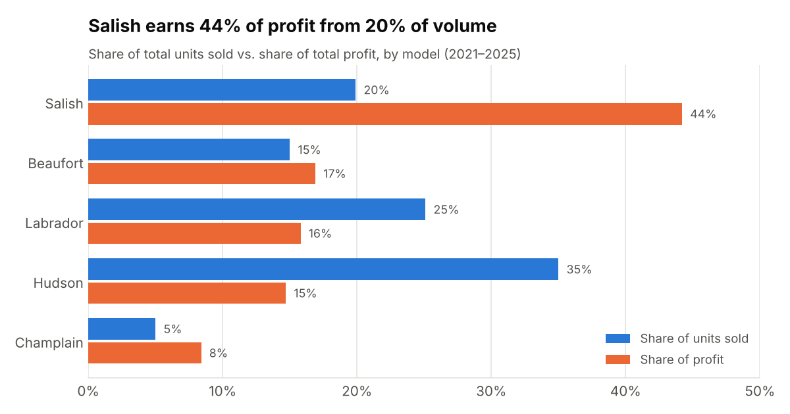
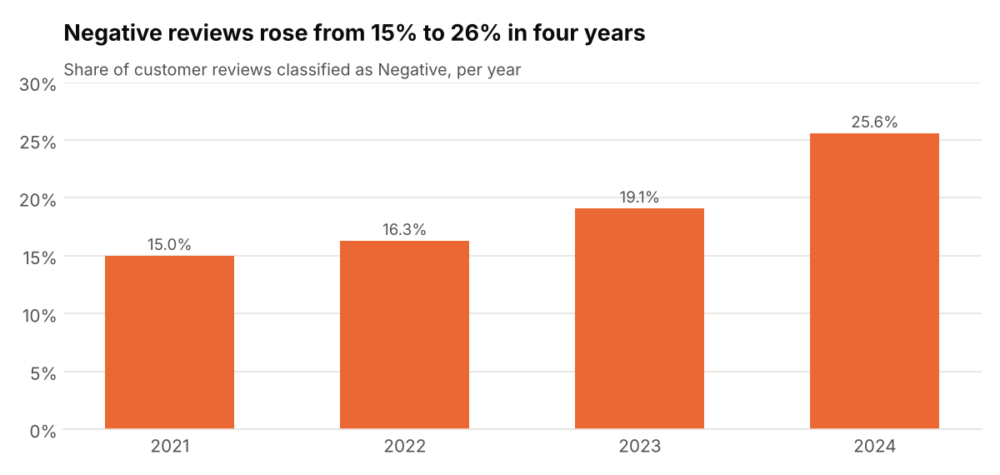

# 💡 Business Insights

The dashboards answer *what is happening*. This document follows up on the questions they raise, using the queries in [`sql/dashboard_queries.sql`](../sql/dashboard_queries.sql) (the `extra_*` blocks). All figures come from [`reports/kpi_validation_report.md`](../reports/kpi_validation_report.md).

> **Scope:** sales Jan 2021 – Dec 2025 · recalls Jan 2020 – Dec 2024 · reviews Jan 2021 – Dec 2024.

---

## 1. Volume is not profit

| Model | Units sold | Share of units | Profit | Share of profit | Profit per unit |
|---|---:|---:|---:|---:|---:|
| Salish | 11,555 | 19.9% | $34.6M | **44.2%** | **$2,996** |
| Beaufort | 8,731 | 15.0% | $13.3M | 16.9% | $1,519 |
| Labrador | 14,571 | 25.1% | $12.4M | 15.8% | $851 |
| Hudson | 20,365 | **35.0%** | $11.5M | 14.7% | $565 |
| Champlain | 2,896 | 5.0% | $6.6M | 8.4% | $2,288 |

The *Quantity Sold by Model* panel makes **Hudson** look like the star. Measured by profit, **Salish** is: each Salish sold earns about **5× a Hudson**.

**Recommendation:** add *profit per unit* to the Sales dashboard and weight sales incentives and inventory toward Salish and Champlain, which have the highest margins.

---

## 2. Customer sentiment is deteriorating everywhere

The treemap shows an overall healthy split (58.6% positive, 22.5% neutral, 19.0% negative). Split by year, the trend is worrying:

| Year | Reviews | Negative | Positive |
|---|---:|---:|---:|
| 2021 | 15,769 | 15.0% | 60.1% |
| 2022 | 22,331 | 16.3% | 61.7% |
| 2023 | 20,727 | 19.1% | 58.5% |
| 2024 | 17,802 | **25.6%** | 53.4% |

Review postal codes match dealer zip codes one-to-one, so every review can be attributed to a dealership. All ten dealers end up between **17.9% and 19.8%** negative overall, and every one of them rose to 24%–28% in 2024. **No single showroom is responsible.** The problem is chain-wide, which points to the product or a company-wide process.

The complaint keywords support this:

| Complaint | Mentions |
|---|---:|
| Fluid leaks | **981** |
| Paint | 410 |
| Recalls | 220 |
| Cold issues | 132 |
| Overheating | 123 |
| Unfriendly service department | 122 |

*Fluid leaks* is mentioned **2.4× more** than the next complaint, and 9 of the 10 complaints are about the vehicle rather than the service department.

**Recommendation:** add a *negative-review share by year* trend to the Service dashboard, and raise fluid leaks and paint quality with the manufacturer.

---

## 3. Recall outliers

The heat map was requested to "spot outliers for a given model or system". Two cells stand out:

| Model × System | Recalled units | Note |
|---|---:|---|
| **Beaufort × Airbag** | **70.4K** | Largest cell; a safety-critical system |
| **Champlain × Suspension** | **60.9K** | Champlain sells only 5% of units but has the 2nd-largest cell |
| Hudson × Airbag | 52.0K | Airbags again |

Across all models, **Airbag** is the most-recalled system (194K units), followed by *Seats and Restraints* (147K) and *Suspension* (144K). Two of the top three systems are occupant-safety systems.

**Caveat:** about 22% of the recall volume is duplicated (2020 rows are a copy of 2021, see [data issue #1](../data/README.md#5-known-data-quality-issues)). Rankings are unchanged, but totals are overstated.

---

## 4. Seasonality

| | Units | Profit |
|---|---:|---:|
| **Peak: May** | 5,834 | $8.02M |
| Low: August | 3,574 | $4.72M |
| **Low: December** | 3,146 | $4.17M |

December volume is **46% below May**. Spring (March–May) and November are strong; August and December are weak.

**Recommendation:** plan inventory and promotions around the May peak, and schedule service campaigns or staff training in August and December.

---

## 5. 2024 was a down year on several fronts

| Signal | 2023 | 2024 | Change |
|---|---:|---:|---:|
| Units sold | 12,750 | 10,633 | **−16.6%** |
| Profit | $16.90M | $15.20M | **−10.0%** |
| Recalled units | 195K | 296K | **+52%** |
| Negative reviews | 19.1% | 25.6% | **+6.5 pp** |

These four signals moved together in 2024. The data cannot prove that recalls and poor reviews *caused* the sales drop, but the overlap is a strong reason to look at the three dashboards side by side instead of separately. That argues for a **shared year filter** across the Sales and Service tabs.

---

## 6. Dealer spread

The most profitable dealer (**1288, Northern Auto Sales, Denver: $9.60M**) earns **56% more** than the least profitable (**1222, Suwanda's Auto, Westminster: $6.15M**). Sentiment is nearly identical across dealers (§2), so the gap is unlikely to be caused by customer experience. Location, size or model mix are better candidates for follow-up.
